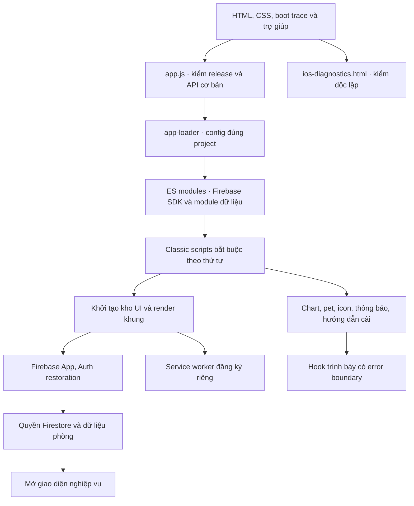

# Đường khởi động P708

- HTML đầu tiên có watchdog độc lập, link trang kiểm tra và đường sao chép báo cáo. Trace tối đa 30 mốc có release, thời gian, thời lượng từ đầu và mã lọc. Watchdog 15 giây hiện bước lỗi. Nút thử lại có chủ đích và giữ kho lưu trữ.
- `app-loader.js` lấy config và import SDK bằng hàm async tường minh. `coreParts` giữ các phụ thuộc data/permissions, các hành động và các chính sách nghiệp vụ 29–28. Classic scripts tải song song và thực thi theo thứ tự chèn. Lỗi core dừng khởi động với mã riêng.
- Phần tùy chọn bắt đầu sau khi launcher core chạy và Auth SDK hoàn thành lượt khôi phục ban đầu. Core đọc trạng thái Auth và mở dữ liệu khi quyền đã được xác nhận. Pet, chart, thông báo và hướng dẫn có hook bắt lỗi khi render. Module tùy chọn không tải được được ghi trong `FEATURES_READY`. Thông báo được kích hoạt sau khi gắn được handler.
- SDK Auth giữ nguyên persistence do Firebase quản lý. Firestore chính giữ memory cache. Chẩn đoán tạo app riêng dùng memory Auth và Firestore, qua một đường dẫn thử nghiệm bị Rules từ chối, không tải thông tin phòng.
- Đăng ký worker không khóa bước Auth. Quy tắc scope, manifest và URL cài đặt giữ nguyên. Trang diagnostics và các module probe đi trực tiếp qua network.
