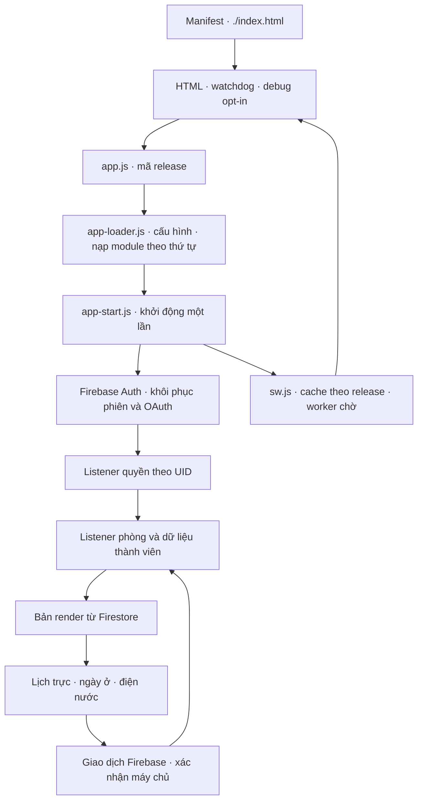

# P708 · Kiến trúc PWA

## Khởi động và quyền

- HTML mở nhanh và có nút thử lại khi tải quá 15 giây. Thử lại chủ động đi qua network và giữ IndexedDB, đăng ký service worker, Cache Storage và các tab đang dùng. `app.js` kiểm phiên bản từ URL. Loader kiểm phiên bản và nạp ES modules rồi các script cổ điển theo thứ tự thực thi. App chỉ bắt đầu gắn UI và Auth khi các thành phần đã nạp.
- Engine giữ một lượt khôi phục Auth và một listener Auth. `restoring → signedOut/signingIn` hoặc `restoring → checking → pending/denied/loadingRoom → active`. Lỗi quyền, tải phòng và kết nối có trạng thái riêng. Gate khóa nội dung đến khi xác nhận quyền và dữ liệu từ máy chủ. Mất mạng không tự gọi đăng xuất.
- Redirect cần hostname khớp authDomain và sessionStorage ghi/đọc được. Emulator dùng helper giả lập. Popup nối cùng phiên ứng dụng nếu trình duyệt hỗ trợ. WebView hướng dẫn mở link qua Safari/Chrome. Khi sessionStorage bị hạn chế, Auth vẫn có cơ chế fallback do SDK quản lý. Nếu SDK chỉ dùng bộ nhớ, phiên chỉ có hiệu lực khi app đang mở.
- `pageshow`, `visibilitychange`, `pagehide` và `online` chạy trong engine. Khi quay lại foreground, kiểm tra dữ liệu phòng bằng một lượt đọc máy chủ và giữ subscription đang hoạt động. Nếu listener đã báo lỗi, chạy lại xác minh quyền và subscription. Dữ liệu phòng áp dụng theo revision và session đang mở.

## Phiên bản và cache

- Manifest giữ nguyên định danh, origin, scope và `start_url`. Đường dẫn nhanh dùng hash. Khi mở thông báo, worker gửi hash cho cửa sổ đang mở để chuyển màn hình trong app.
- Service worker đăng ký ở `sw.js` theo cùng scope. Tệp HTML đi qua network và khớp release của worker đang giữ trang. Khi server đã sang bản mới, worker đang chạy có thể dùng HTML và tài nguyên của bản hiện tại đã precache trong lúc đợi bản mới. Nếu mạng lỗi, worker trả trang ngoại tuyến của app.
- Khi cài, worker kiểm MIME và release HTML, boot và loader. JS/CSS dùng query `v` nhất quán với cache key. Nếu thiếu mục cache, worker kiểm build server trước và sau khi tải mã. Config, OAuth, API, request ngoài origin và callback params đi qua network. Hosting bỏ catch-all rewrite vì các màn hình dùng hash.
- Worker mới chờ cho tới khi các cửa sổ cũ đã đóng hoặc người dùng bấm **Cập nhật**. App kiểm tra Auth, thao tác Firebase và form. Worker kiểm các cửa sổ khác cùng scope. App kiểm điều kiện lần nữa khi controller đổi. Worker giữ cache hiện tại và một cache bản trước để hoàn thành lượt điều hướng đã bắt đầu trước lúc chuyển controller. Cache cũ hơn chỉ được dọn trong scope P708.
- `p708-build.json` trên môi trường phát hành được sinh từ commit và release. Cấu hình Firebase lấy runtime riêng. Mục **Tài khoản & phân quyền** hiện release đang chạy, chẩn đoán hiện thêm worker và release server.
